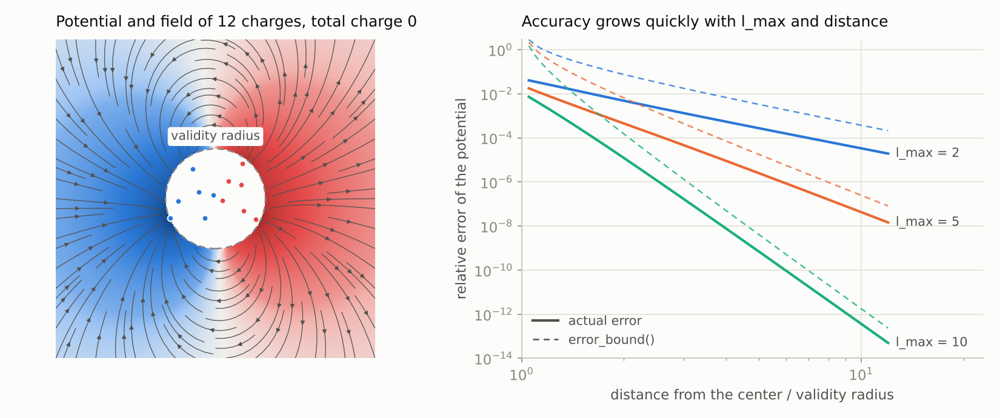

# multipoles

<p>
<a href="https://pypi.org/project/multipoles/"></a>
<a href="https://pypi.org/project/multipoles/"></a>
<a href="https://github.com/maroba/multipoles/actions/workflows/python-app.yml"></a>
<a href="https://codecov.io/gh/maroba/multipoles"></a>
<a href="https://maroba.github.io/multipoles/"></a>
<a href="https://github.com/maroba/multipoles/blob/master/LICENSE"></a>
</p>

<picture>
  <source media="(prefers-color-scheme: dark)" srcset="https://raw.githubusercontent.com/maroba/multipoles/master/docs/images/readme-dark.png">
  
</picture>

<!-- --8<-- [start:intro] -->
**Fast potentials and fields of charge and mass distributions, far away from them or in the empty space
inside them.**

*multipoles* computes the multipole expansion of point charges or of a charge density on a grid. Instead of
summing over all charges for every point where you need the potential, you compute a few multipole moments
once and then evaluate the potential anywhere at the cost of a short sum, with a rigorous bound for the error.
Typical uses are

- boundary conditions for Poisson solvers on finite grids,
- gravitational potentials in N-body and astrophysical simulations,
- the electrostatics of molecules and clusters of charges, seen from a distance.

<!-- --8<-- [end:intro] -->

**[Documentation](https://maroba.github.io/multipoles/)** ·
**[Changelog](https://github.com/maroba/multipoles/blob/master/CHANGELOG.md)**

<!-- --8<-- [start:features] -->
## Features

- **Point charges or charge densities**, also on unevenly spaced grids
- **Potential, field and Hessian**, computed analytically, at single points, for whole arrays, or directly on
  the grid, e.g. as boundary values for a Poisson solver
- **Controlled accuracy:** an error bound for every point, and `l_max='auto'` to reach a given tolerance
- **Exterior and interior expansions** about any center, which you can move, add, scale, save and load
- **Moments in the common conventions:** spherical in Racah, orthonormal or real form, and cartesian of any
  order
- **Electrostatics or gravity:** Gaussian or SI units, or masses with the gravitational constant

<!-- --8<-- [end:features] -->

## Installation

```bash
pip install multipoles
```

*multipoles* only needs NumPy. For plotting, install it with `pip install "multipoles[plot]"`.

<!-- --8<-- [start:quickstart] -->
## Quickstart

Two point charges +1 and -1 on the z-axis:

```python
from multipoles import MultipoleExpansion

Phi = MultipoleExpansion.from_charges(q=[1, -1], xyz=[(0, 0, 1), (0, 0, -1)], l_max=8)

Phi(0, 0, 10)               # 0.0202020199..., exact: 1/9 - 1/11 = 0.0202020202...
Phi(0, 0, 10, l_max=1)      # 0.02, only monopole and dipole
Phi.field(0, 0, 10)         # [0, 0, 0.004081], the field E = -∇Φ
Phi.error_bound(0, 0, 10)   # 2.2e-10, an upper bound of the truncation error
Phi.dipole_moment           # [0, 0, 2]
```

A charge density on a grid, with `l_max` chosen for a relative accuracy of 1e-6 on the boundary of the grid:

```python
import numpy as np

x = y = z = np.linspace(-10, 10, 101)
X, Y, Z = np.meshgrid(x, y, z, indexing='ij', sparse=True)
rho = np.exp(-(X**2 + Y**2 + (Z - 1)**2)) - np.exp(-(X**2 + Y**2 + (Z + 1)**2))

Phi = MultipoleExpansion.from_density(rho, (x, y, z), l_max='auto')
boundary = Phi.boundary_values()   # the potential on the boundary of the grid
```

*multipoles* computes Φ = Σ q / r, the potential in Gaussian units. Pass `prefactor='SI'` for SI units, or the
masses as charges and `prefactor='gravity'` for the gravitational potential. For the interior expansion, the
moments, and more, see the [usage guide](https://maroba.github.io/multipoles/usage/).

<!-- --8<-- [end:quickstart] -->

## Related Projects

To solve the Poisson equation on a grid, e.g. with the boundary values from `boundary_values()`, you can use
[findiff](https://github.com/maroba/findiff), which builds finite difference operators of any order on
any grid.

## Citing

If you use *multipoles* in your research, please cite it. GitHub shows the citation in APA and BibTeX format under
**Cite this repository** on the [repository page](https://github.com/maroba/multipoles), based on
[CITATION.cff](CITATION.cff).

## Contributing

Bug reports, ideas and pull requests are welcome, see [CONTRIBUTING.md](CONTRIBUTING.md). *multipoles* is
released under the [MIT license](LICENSE).
